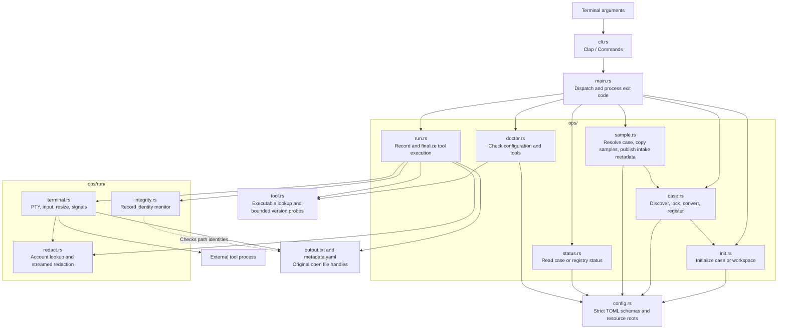
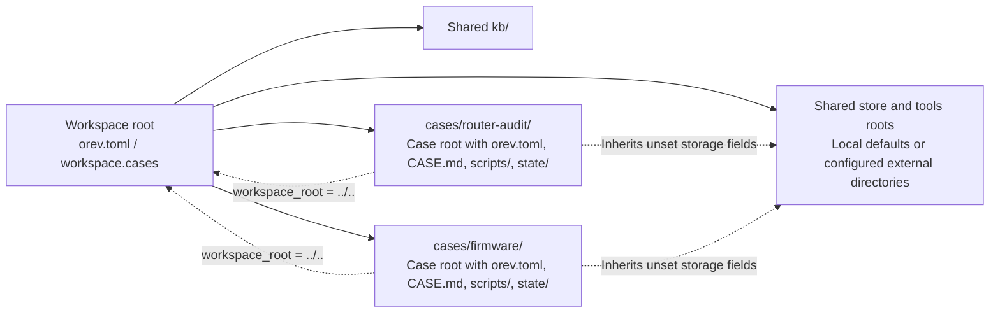
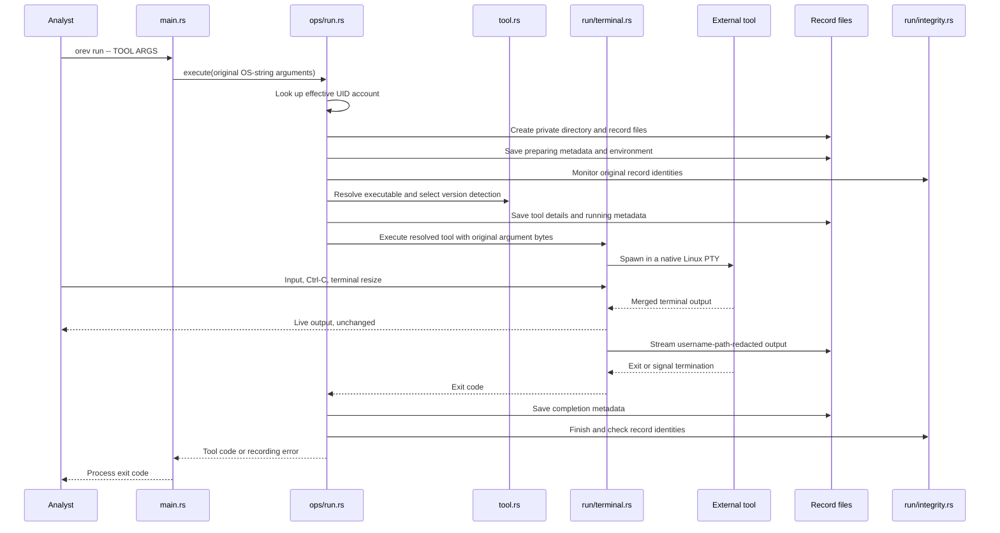

# Orev architecture

Orev is a Linux CLI that manages analysis cases and records external tool runs.
It has no server, database, or automatic analysis pipeline.
The filesystem holds configuration, case state, and execution records.
Use the [canonical glossary](../glossary.md) for case, case root, workspace, workspace root, and `config_root`.
See [Behavior contracts](behavior-contracts.md) for implementation constraints and regression requirements.

## Code dependencies

The diagram shows command flow, module calls, and record writes.
`main.rs` parses a `Commands` enum from Clap and calls the selected operation.
Operations own filesystem access, tool execution, and their existing progress output.



`run` does not depend on `config`.
It works in any current directory without `orev.toml`.
`doctor` and `run` use the same executable discovery and version rules in `tool.rs`.
Ghidra version detection reads installation properties instead of executing its launcher.
`sample` reuses case-name and configuration-file validation from `case`.

## Case and workspace resources

`RootConfig` distinguishes `Case(CaseConfig)` from `Workspace(WorkspaceConfig)`.
`CaseConfig` represents a standalone case or workspace case.
`WorkspaceConfig` represents a multi-case workspace, with its ordered registry in `WorkspaceInfo`.
Both schemas reject unknown TOML fields.
`CaseConfig.workspace_root` is the top-level workspace association field.
There is no compatibility alias for the old field.
See the [manual migration note](../user/workspaces.md#migrate-the-workspace-association-manually).



A standalone case has its own `kb`, `store`, and `tools` defaults.
A workspace case resolves shared resources through `workspace_root`.
Each explicit case storage field overrides the workspace setting or default for that field.
Unset fields follow workspace configuration changes without rewriting case files.
Saved overrides and resolved runtime paths are separate.
Relative overrides use the declaring configuration's directory as their base, not the current working directory.
Configured storage roots must already exist outside that configuration root after symbolic link resolution.
Absolute overrides remain supported.

`case add` finds the nearest configuration, then locks the workspace before it validates and changes the registry.
For a standalone case, it stages the conversion and the new case together.
The staged initializer uses the proposed workspace context while the root configuration still describes the standalone case.
Conversion keeps storage settings in the workspace configuration, preserving their relative path base.
Both cases inherit those settings rather than saving duplicate paths.
It publishes the updated registry after moving the cases into place.
Handled failures undo recorded moves in reverse order.
An incomplete rollback retains recovery data and reports its location.
This is not a crash-safe transaction.

See [Workspaces and configuration](../user/workspaces.md) for user-facing layouts and conversion limits.

## Recorded tool execution



The runner keeps the original open handles if record paths disappear or change.
It does not recreate deleted files or overwrite replacements.
A detected integrity failure leaves the tool running, but makes Orev return 1.
When the original metadata remains writable, the runner records the actual tool code alongside the recording error.

Path redaction applies to stored output and metadata values, not live output or executed arguments.
The redactor retains partial username matches between PTY reads.
See [Tool runs](../user/tool-runs.md) for record fields, permissions, and privacy limits.

## Command-dispatch refactor

The previous command path was:

```text
main.rs -> commands/<command>.rs -> ops/<command>.rs
```

The command adapters forwarded arguments, selected the initialization mode, or printed runner errors.
They did not define a separate application model.
The refactored path is:

```text
main.rs -> ops/<command>.rs
```

The existing `Commands` enum remains the complete dispatch model.
One exhaustive match in `main.rs` selects the operation and converts its result to a process exit code.
No new traits, services, or compatibility adapters replace the deleted modules.

The alternatives were:

| Structure | Decision |
| --- | --- |
| Keep one file per command adapter | Reject. Most adapters forward the same arguments without adding policy. |
| Consolidate all dispatch in `commands::execute` | Reject for now. It preserves an extra call boundary without hiding domain complexity. |
| Dispatch directly in `main.rs` | Keep. Command selection and process exit handling fit in one match, while operations retain their existing responsibilities. |

This refactor leaves the operation implementations unchanged.
It does not turn operations into a pure library or redesign diagnostic ownership.

The process contract remains:

| Command or outcome | Output and exit policy |
| --- | --- |
| `init`, `case add`, `doctor` | Operations report errors. Success returns 0 and handled errors return 1. |
| `status` | The operation prints status or configuration diagnostics. It can return 0 after a configuration error. |
| `run` with a completed tool | Return the tool code, including `128 + signal` for signal termination. |
| `run` with a runner or record error | `main.rs` prints `Error: ...` once and returns 1. |
| Invalid CLI arguments | Clap prints the parse error and returns 2. |
| Help or version request | Clap prints the requested information and returns 0. |

The `status` limit is documented behavior, not a change introduced by this refactor.
See [Diagnostics](../user/diagnostics.md).

## Verification boundaries

The integration suites drive the actual binary from private temporary directories.
They cover initialization preservation, workspace conversion and rollback, discovery, strict schemas, shared storage, tool version detection, argument bytes, PTY interaction, signals, record integrity, and redaction.
The command-dispatch characterization checks also pin missing-configuration output, the existing `status` exit behavior, and single runner-error reporting.

The [CLI verification skill](../../.agents/skills/verify-orev/SKILL.md) drives the binary through tmux.
The [redaction verification skill](../../.agents/skills/verify-redaction/SKILL.md) describes the bounded-exhaustive redaction checks.
Neither constitutes proof of crash recovery, tamper-proof logging, or correctness of external analysis tools.
